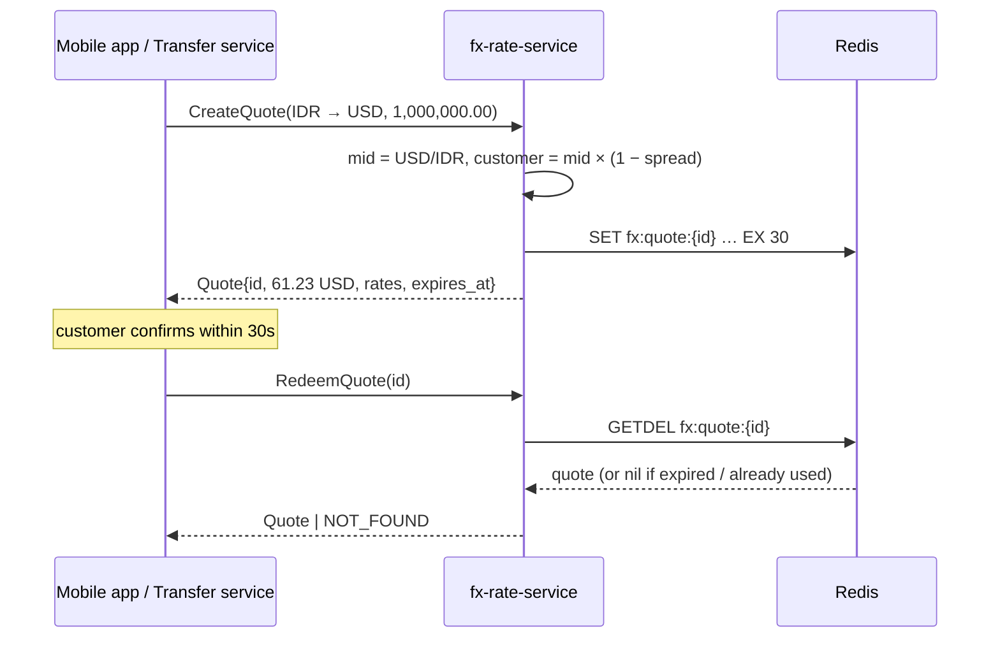

# fx-rate-service

A gRPC service that prices currency conversions and **locks the quoted rate** for a short time,
built with Java 17, Spring Boot, grpc-java and Redis. A client asks for a quote, shows it to the
customer, and redeems it when the customer confirms — at exactly the quoted amount, once.


It is the multi-currency building block for
[payment-ledger-service](https://github.com/marvinds1/payment-ledger-service): before booking a
cross-currency transfer, the ledger redeems a quote and books both legs at the locked rate.

## Highlights

| Concern | How it is handled |
|---|---|
| Rate lock | A quote is stored in Redis with a TTL (default 30s). The customer gets the price they saw, not the price at execution time. |
| Exactly-once redemption | Redeeming uses Redis `GETDEL`, which is atomic: of many concurrent redeems for one quote, exactly one succeeds (tested with 8 parallel calls). Expired or used quotes return `NOT_FOUND`. |
| Money math | `BigDecimal` with 16 significant digits for rates; amounts are integer minor units. Only the final amount is rounded, always **down** to the target currency's minor unit (respects 0-decimal currencies like JPY). |
| Cross rates | All rates are kept against USD; `IDR→SGD` is derived as `SGD/USD ÷ IDR/USD`, so N currencies need N rates, not N². |
| Spread | Configurable margin in basis points, returned on the quote alongside the mid and customer rate for transparency. |
| Contract-first API | Protobuf schema in [`src/main/proto`](src/main/proto/fx/v1/fx_service.proto), versioned package `fx.v1`. Errors use gRPC status codes (`INVALID_ARGUMENT`, `NOT_FOUND`) with readable descriptions. |
| Operability | Standard gRPC health service, server reflection (works with `grpcurl` / Postman), one access-log line per call (method, status, latency), graceful shutdown inside the Spring lifecycle. |

## Flow



## API

| RPC | Description |
|---|---|
| `CreateQuote(sell_currency, buy_currency, sell_amount_minor)` | Price and lock a conversion |
| `RedeemQuote(quote_id)` | Consume a quote exactly once |
| `ListRates(base_currency)` | Indicative mid rates against a base (not lockable) |
| `grpc.health.v1.Health/Check` | Health |

With [grpcurl](https://github.com/fullstorydev/grpcurl) (reflection is enabled, no proto file needed):

```bash
grpcurl -plaintext -d '{"sell_currency":"IDR","buy_currency":"USD","sell_amount_minor":100000000}' \
  localhost:9090 fx.v1.FxService/CreateQuote
```

```json
{
  "quoteId": "5b0d6c1e-…",
  "sellCurrency": "IDR",
  "buyCurrency": "USD",
  "sellAmountMinor": "100000000",
  "buyAmountMinor": "6123",
  "midRate": "0.00006153846153846154",
  "customerRate": "0.00006123076923076923",
  "spreadBps": 50,
  "expiresAt": "2026-11-23T04:30:30Z"
}
```

```bash
grpcurl -plaintext -d '{"quote_id":"5b0d6c1e-…"}' localhost:9090 fx.v1.FxService/RedeemQuote
```

## Configuration

```yaml
fx:
  spread-bps: 50          # 0.50%
  quote-ttl: 30s
  rates-per-usd:          # demo mid-market rates
    USD: 1
    IDR: 16250
    SGD: 1.3420
    JPY: 151.80
```

Environment: `GRPC_PORT` (default 9090), `REDIS_HOST`, `REDIS_PORT`.

## Running locally

Requirements: Java 17, Maven, Docker.

```bash
docker compose up --build    # Redis + the service on :9090
mvn verify                   # unit tests + gRPC integration tests (Testcontainers Redis)
```

## Project layout

```
src/main/proto/fx/v1/         Protobuf contract (Java stubs are generated at build time)
src/main/java/io/github/marvinds1/fx/
  pricing/    Pricer (rate math), FxProperties
  quote/      QuoteService, Redis QuoteStore (SET EX / GETDEL)
  grpc/       FxGrpcService, GrpcServer lifecycle, access-log interceptor
```

## Roadmap

- Pull rates from a market data feed and refresh them on a schedule, with a staleness guard that refuses to quote on old rates.
- Per-customer-segment spreads and amount tiers.
- Idempotent `CreateQuote` with a client request id.
- Publish `fx.quote-redeemed` events so the ledger books FX gains/losses.
- Micrometer metrics for quote/redeem rate and expiry ratio.

## License

MIT
